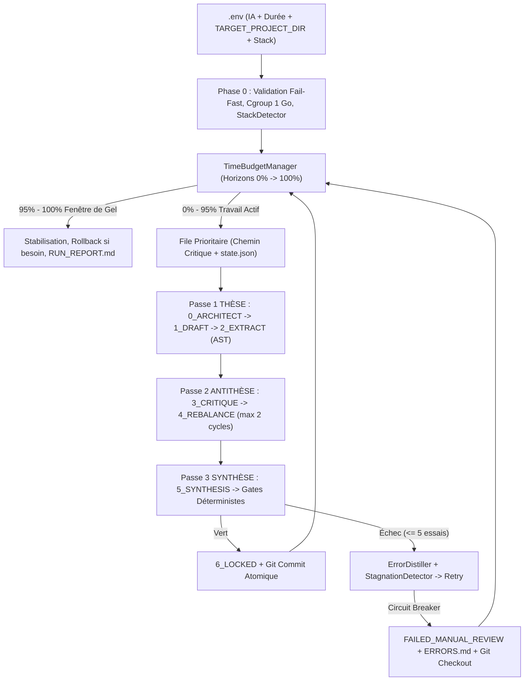

# StructuredAI — Framework d'Orchestration IA Autonome (Time-Boxed & <= 1 Go RAM)

**StructuredAI** est un framework d'ingénierie logicielle autonome conçu pour piloter des **modèles d'IA locaux ultra-légers** (à partir de 0.5B–1B de paramètres, sous un plafond strict de **1 Go de RAM**) pendant une **durée configurable** (par exemple 24 heures sans intervention humaine), dans **n'importe quel dossier de projet** et sur **n'importe quelle stack technologique**.

> [!NOTE]
> Ce dépôt contient actuellement l'**architecture documentaire complète** et les spécifications techniques du framework, conçues à partir du document fondateur [Architecture Système - Orchestrateur IA Autonome 2....md](Architecture%20Syst%C3%A8me%20-%20Orchestrateur%20IA%20Autonome%202....md).

---

## 🎯 Pourquoi ce Framework ?

Faire tourner un petit modèle (`0.8B`–`1.5B` dans `4096 tokens` de contexte) pendant 24 heures sur un vrai projet logiciel échoue systématiquement avec des approches naïves (agents conversationnels, frameworks lourds, absence de bornes temporelles ou confiance aveugle dans les réponses du modèle).

**StructuredAI** résout ce problème par une approche **Neuro-Symbolique, Dialectique et Pilotée par le Temps** :
1. **Budget RAM strict (`<= 1 Go`)** : exécution *stateless* via `llama-server`, `ollama` ou API compatible OpenAI, cache KV quantifié (`q8_0`), sans mémoire conversationnelle.
2. **Paramétrage intégral par `.env`** : choix du modèle IA, du temps alloué (`30m`, `4h`, `24h`...), du dossier cible (`TARGET_PROJECT_DIR`) et de la stack.
3. **Moteur Temporel Adaptatif** : découpage automatique du temps en 5 horizons (Ingestion, Construction, Rééquilibrage, Durcissement, Fenêtre de Gel finale) pour livrer un projet **compilable et testé** quelle que soit la durée choisie.
4. **Adaptateur Universel de Stack** : auto-détection ou profils déclaratifs (`stack.toml`) pour Python, Node/TypeScript, Rust, Go, C/C++, Java, Web statique ou stack personnalisée, en mode *Greenfield* (nouveau projet) comme *Brownfield* (projet existant).
5. **Fiabilité Neuro-Symbolique** : extraction AST déterministe des signatures (`REALITY.md`), vérificateur d'imports pré-vol, distillateur d'erreurs, détecteur de boucles stériles, garde anti-tests-factices, et commits Git atomiques sur branche isolée.

---

## 📚 Cartographie de la Documentation

| Document | Objet | Ce que vous y trouverez |
| :--- | :--- | :--- |
| [`.env.example`](.env.example) | **Configuration rapide** | Modèle complet des variables d'environnement (IA, Temps, Dossier cible, RAM, Stack, Sécurité). |
| [01 — Architecture & Principes](docs/01-architecture-et-principes.md) | **Fondations système** | Les 8 invariants non-négociables, l'architecture modulaire du framework et les flux de données. |
| [02 — Configuration `.env` & Profils IA](docs/02-configuration-env-et-profils-ia.md) | **IA & Matériel <= 1 Go** | Référence complète du `.env`, backends supportés, calculateur RAM, cgroups v2, watchdog thermique & OOM. |
| [03 — Moteur Temporel & Cycle Dialectique](docs/03-moteur-temporel-et-cycle-dialectique.md) | **Temps & Machine à États** | Horizons temporels (0–100%), ordonnancement par chemin critique, 3 passes Thèse/Antithèse/Synthèse, reprise sur crash. |
| [04 — Adaptateurs de Stacks & Projets](docs/04-adaptateurs-stacks-et-projets.md) | **Polyglotte & Universel** | Auto-détection, Greenfield vs Brownfield, interface à 6 hooks déterministes, profils par langage et `stack.toml`. |
| [05 — Fiabilité Neuro-Symbolique & Autonomie](docs/05-fiabilite-neuro-symbolique-et-autonomie.md) | **Innovations Anti-Dérive** | `REALITY.md` hybride AST+LLM, pré-vol d'imports, distillation d'erreurs, détection de stagnation, anti-tests-factices, Git & PathJail. |
| [06 — Contrats, Prompts & Grammaires GBNF](docs/06-contrats-prompts-et-grammaires-gbnf.md) | **Zéro bavardage** | Découpage strict des `4096 tokens`, prompts ultra-compacts des 6 micro-agents, schémas JSON et grammaires GBNF. |
| [07 — Protocoles Fichiers & Observabilité](docs/07-protocoles-fichiers-et-observabilite.md) | **Artefacts & Pilotage** | Mode `shadow` vs `inline`, format de `SPEC.md`, `CONTRACT.md`, `REALITY.md`, `DASHBOARD.md`, `RUN_REPORT.md`. |
| [08 — Plan d'Implémentation & Vérification](docs/08-plan-implementation-et-verification.md) | **Feuille de route** | Structure du code Python (`<= 100 lignes/fichier`), **12 scénarios de Chaos Testing** et checklist avant lancement multi-jours. |
| [09 — Audit de Failles & Blindage Multi-Jours](docs/09-audit-failles-et-blindage-multi-jours.md) | **Résilience SRE (48h–7j+)** | Matrice Red-Team des failles (cycles DAG, *reward hacking*, saturation disque, *Ripple*, sécurité hôte) et garde-fous déterministes. |
| [10 — Cockpit Zed, `install.sh` & `start.sh`](docs/10-cockpit-zed-et-pilotage.md) | **Prise en main Fedora + Zed** | Installation sans option sous Fedora, configuration interactive `.env`, tâches Zed et pilotage temps réel (`STEERING.md`). |
| [Templates](docs/templates/SPEC.template.md) | **Modèles prêts à l'emploi** | Modèle de `SPEC.template.md` et `stack.template.toml` pour initialiser un nouveau projet cible. |

---

## 🧭 Vue d'Ensemble de la Boucle Autonome



---

## 🚀 Démarrage Rapide sous Fedora + Zed

1. **Installer en une commande (sans option)** :
   ```bash
   ./install.sh
   ```
   Installe les dépendances Fedora, `llama-server`, **Zed** (Flatpak si absent), le `.venv` Python, vous assiste pour créer `.env`, télécharge le modèle léger configuré et **ouvre Zed** automatiquement.
2. **Rédiger votre objectif** : adaptez `SPEC.md` dans `TARGET_PROJECT_DIR` (modèle : [docs/templates/SPEC.template.md](docs/templates/SPEC.template.md)).
3. **Démarrer & Piloter depuis Zed** : lancez la tâche **`StructuredAI: Demarrer / Reprendre (start.sh)`** (ou `./start.sh`), suivez `.orchestrator/DASHBOARD.md` en aperçu live et influencez l'agent via `.orchestrator/STEERING.md`.
