# 01 — Architecture Système & Invariants Fondamentaux

Ce document pose les fondations conceptuelles de **StructuredAI** : comment transformer un modèle de langage ultra-léger (sous `1 Go` de RAM, contexte `4096 tokens`) en un ingénieur logiciel autonome fiable sur des durées de quelques minutes à **24 heures consécutives**, sur **n'importe quel projet et stack technologique**.

---

## 1. De la Spécification Initiale au Framework Générique

Le document d'origine ([Architecture Système - Orchestrateur IA Autonome 2....md](../Architecture%20Syst%C3%A8me%20-%20Orchestrateur%20IA%20Autonome%202....md)) ciblait une configuration figée (`Qwen3.5-0.8B`, `24h` fixes, `Fedora 44`, tests Python/TS). **StructuredAI** généralise cette architecture en un **framework modulaire** piloté par 4 axes externes définis dans `.env` :

1. **L'Axe IA (`LLM_*`)** : découplage total du fournisseur et du modèle (`llama-server`, `ollama`, ou toute API compatible OpenAI), tout en conservant l'optimisation native pour les modèles `< 1B` sous `1 Go` de RAM.
2. **L'Axe Temps (`RUN_DURATION`, `TIME_PROFILE`)** : le temps n'est plus un simple `while time.time() < end`, mais une **ressource budgétée** découpée en horizons adaptatifs garantissant la livraison d'un état propre à l'échéance.
3. **L'Axe Projet (`TARGET_PROJECT_DIR`, `PROJECT_MODE`)** : capacité à créer un projet de zéro (*Greenfield*) ou à intégrer et améliorer un dépôt existant (*Brownfield*) dans un espace strictement confiné.
4. **L'Axe Stack (`TARGET_STACK`, `STACK_PROFILE_PATH`)** : abstraction des compilateurs, linters, extracteurs de symboles et exécuteurs de tests pour fonctionner sur tout langage.

---

## 2. Les 8 Invariants Non-Négociables

Pour qu'un petit modèle ne dérive jamais sur **plusieurs jours consécutifs** (`24h`–`7j+`), le framework impose huit invariants vérifiés par du code déterministe (jamais par l'IA elle-même) :

| # | Invariant | Règle stricte | Justification technique |
| :--- | :--- | :--- | :--- |
| **I1** | **Plafond Mémoire & Disque** | `RAM_LIMIT_MB = 1024`, `DISK_MIN_FREE_MB >= 2048` | Évite swap SSD, OOM killer et panne `ENOSPC` sur plusieurs jours ; rotation des logs et purge des caches/tags. |
| **I2** | **Zéro Mémoire Conversationnelle** | Chaque appel LLM part d'un historique vide (`0` tour précédent) | Empêche la pollution progressive du contexte et la dérive sémantique cumulative sur des milliers d'itérations. |
| **I3** | **Modularité & Topologie DAG** | `MAX_LINES_PER_FILE <= 100`, `MAX_TREE_DEPTH <= 4`, zéro cycle d'import | Un module court tient dans `4096 tokens` ; la détection de cycles et la limite de profondeur empêchent l'explosion de micro-fichiers. |
| **I4** | **Vérité Neuro-Symbolique** | L'AST / compilateur / linter fait foi ; jamais le LLM | L'extraction de signatures (`REALITY.md`, `DEPS_REALITY.md`), le pré-vol d'imports et l'anti-triche sont 100 % déterministes. |
| **I5** | **Noyau Sans Framework Agentique** | Pas de LangGraph / CrewAI / AutoGen | Économise 1 500 à 3 000 tokens de prompts cachés. StructuredAI est une machine à états Python pure (`< 150` tokens de prompt système). |
| **I6** | **Confinement, Verrou & Git Sélectif** | `PathJail` + `PROTECTED_PATHS` + `flock` + branche `ai-auto` + port `18080` | Interdit à l'IA de modifier `SPEC.md`/`.env`/`.orchestrator/`, empêche les doubles lancements et les fuites de secrets dans Git. |
| **I7** | **Fermeture Temporelle Sûre** | Fenêtre de gel finale (`FREEZE_WINDOW_RATIO = 5%`) + horloge active | Horloge immunisée contre la veille/NTP ; convergence garantie vers un tag `green-step-*` vérifié de bout en bout. |
| **I8** | **Non-Régression & Monotonie** | Invalidation en cascade sur changement d'AST + interdiction d'affaiblir les tests | Empêche l'effet "tests unitaires verts mais application cassée" et le *reward hacking* consistant à vider code ou assertions. |

---

## 3. Architecture Modulaire en Couches

Le framework sépare strictement l'**intelligence probabiliste** (stateless, bornée, remplaçable) de la **mécanique déterministe** (état, temps, validation, sécurité) :

```mermaid
flowchart LR
    subgraph Control["1. Couche Pilotage Déterministe"]
        CFG["ConfigLoader (.env)"]
        TBM["TimeBudgetManager (Horizons)"]
        SM["StateMachine (state.json + WAL)"]
    end

    subgraph Agents["2. Couche Micro-Agents Stateless"]
        PR["PromptBuilder (< 2500 tok)"]
        LLM["LLMClient (llama_cpp / ollama / openai)"]
        GBNF["ConstraintEngine (GBNF / JSON Schema)"]
    end

    subgraph Grounding["3. Couche Garde-Fous Neuro-Symboliques"]
        AST["ASTRealityExtractor"]
        PRE["ImportPreflightChecker"]
        ERR["ErrorDistiller & StagnationDetector"]
        ANTI["AntiTrivialTestGate"]
    end

    subgraph Target["4. Couche Cible & Système"]
        STK["StackAdapter (Python/TS/Rust/Go/Custom)"]
        GIT["GitTxManager & PathJail"]
        WD["ResourceWatchdog (RAM/CPU/Temp)"]
    end

    Control --> Agents
    Agents --> Grounding
    Grounding --> Target
    Target --> Control
```

### Rôle de chaque couche
1. **Couche Pilotage Déterministe** : lit `.env`, calcule les budgets de temps par phase et par nœud, choisit le prochain nœud sur le chemin critique et persiste chaque transition de manière atomique.
2. **Couche Micro-Agents Stateless** : assemble un prompt ultra-dense (`< 2500 tokens`), force la sortie via grammaire GBNF ou JSON Schema, désactive `<think>`, et récupère un objet structuré validé.
3. **Couche Garde-Fous Neuro-Symboliques** : vérifie la structure avant même d'invoquer les tests (imports réels, limite de lignes, absence de placeholders), extrait automatiquement les signatures exactes (`REALITY.md`), distille les erreurs et bloque les boucles infinies.
4. **Couche Cible & Système** : exécute les commandes spécifiques à la stack dans un sous-processus borné en temps/RAM/réseau, gère la branche Git isolée et surveille la santé de l'hôte (RSS, température CPU).

---

## 4. Principe de Compression Ascendante et Descente Dialectique

Contrairement aux agents classiques qui empilent tout le code du dépôt dans un gigantesque contexte (impossible sous 1 Go de RAM), StructuredAI maintient une **pyramide d'abstraction à résolution bornée** :

- **À la Descente (Top-Down)** : l'agent ne voit que le `SPEC.md` (ou `CONTRACT.md` parent) et l'index des signatures disponibles dans les dossiers frères (`REALITY.md` agrégés). Il n'a jamais besoin de lire le corps interne d'un autre module.
- **À la Montée (Bottom-Up)** : un fichier de 100 lignes est compressé de manière déterministe en **5 à 15 lignes de signatures exactes** dans `REALITY.md`. Un dossier de 5 fichiers devient un `REALITY.md` de dossier de `<= 20 lignes`.

Ainsi, même si le projet cible atteint **150 fichiers (15 000 lignes)** après 24 heures, le contexte fourni à l'Architecte Critique au sommet reste **inférieur à 2 000 tokens**.

---

## 5. Boucle Vie d'un Run Autonome (Vue Macroscopique)

1. **Bootstrap (`0_INGEST`)** : validation `.env`, création du cgroup/limite RAM, démarrage ou ping du serveur IA, détection de la stack, scan Brownfield éventuel, création de la branche Git `ai-auto`.
2. **Exécution Dialectique Bornée (`0_ARCHITECT` -> `6_LOCKED`)** : construction récursive Thèse -> Antithèse -> Synthèse en respectant les priorités du graphe de dépendances.
3. **Macro-Cycles d'Amélioration (`7_HARDENING`)** : si tous les nœuds sont `6_LOCKED` avant la fin du temps alloué, réouverture contrôlée des nœuds pour augmenter la couverture de tests, traiter les cas limites et améliorer la robustesse.
4. **Fenêtre de Gel (`FROZEN`)** : dans les derniers `5%` du budget temps, interdiction de toute nouvelle fonctionnalité, exécution de la suite globale, restauration éventuelle vers le dernier tag vert (`High-Watermark`) si une régression est détectée, et rédaction du `RUN_REPORT.md`.
