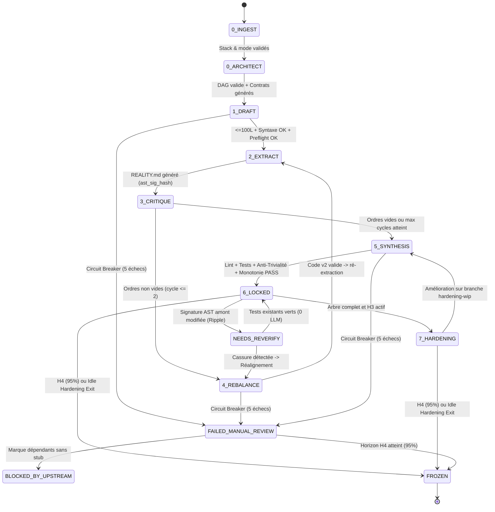

# 03 — Moteur Temporel (`TimeBudgetManager`) & Cycle Dialectique

Un framework autonome basé sur le temps ne peut pas traiter un run de **30 minutes** comme un run de **24 heures**. Sans pilotage temporel actif, un agent risque soit de passer 90 % de son temps à refactoriser le premier module, soit de lancer une refactorisation destructive à 23h58 et de laisser le projet cassé à l'échéance.

**StructuredAI** intègre un **Moteur Temporel à Horizons Adaptatifs** couplé à la **Machine à États Dialectique (Thèse -> Antithèse -> Synthèse)**.

---

## 1. Le Cerveau Temporel (`TimeBudgetManager`)

Au démarrage, `RUN_DURATION` (par exemple `30m`, `4h`, `24h`, `72h`, `7d`) est converti en secondes $T_{\text{total}}$.

### 1.0 Comptabilisation Dual-Clock (`TIME_ACCOUNTING_MODE`)
Une horloge murale naïve (`time.time() - start`) échoue sur plusieurs jours : une mise en veille du PC ou une synchronisation NTP peut faire sauter l'horloge de plusieurs heures et croire le budget expiré prématurément.
* **`active` *(défaut recommandé)*** : un accumulateur incrémente `elapsed_active_seconds` par pas bornés (`dt = min(delta_monotonic, HEARTBEAT_INTERVAL_SEC * 2)`), excluant de fait les mises en veille, pauses thermiques et coupures machine avant reprise.
* **`wall_clock`** : arrêt calendaire strict à `start_wall_ts + T_total` si une échéance horaire réelle est exigée.

Le moteur suit l'avancement normalisé $\tau = \frac{t_{\text{comptabilisé}}}{T_{\text{total}}} \in [0, 1]$.

### 1.1 Découpage en 5 Horizons Temporels

Selon le profil `TIME_PROFILE` défini dans `.env` (`balanced`, `sprint`, `hardening`), le budget temps est alloué à cinq horizons :

| Horizon | Plage par défaut (`balanced`) | Objectif stratégique | Règles actives |
| :--- | :--- | :--- | :--- |
| **H0 — Ingestion & Cadrage** | `0% – 8%` | Détection stack, scan Brownfield ou découpage racine (`0_ARCHITECT`) | Construction de la carte topologique du projet et de la file prioritaire. |
| **H1 — Construction Core (Thèse)** | `8% – 55%` | Création des fondations, types/contrats et modules prioritaires (`1_DRAFT` -> `2_EXTRACT`) | Priorité stricte aux nœuds à fort impact aval (chemin critique). |
| **H2 — Alignement & Synthèse** | `55% – 80%` | Rééquilibrage (`3_CRITIQUE` / `4_REBALANCE`) et verrouillage + tests (`5_SYNTHESIS` -> `6_LOCKED`) | Tout nœud critique doit converger vers `6_LOCKED` avant la fin de H2. |
| **H3 — Durcissement (`7_HARDENING`)** | `80% – 95%` | Macro-cycles : tests d'intégration, cas limites, audit des `FAILED_MANUAL_REVIEW` récupérables | Déclenché dès que l'arbre principal est `6_LOCKED`, ou ciblé sur les nœuds prioritaires. |
| **H4 — Fenêtre de Gel (`FROZEN`)** | `95% – 100%` | **Verrouillage strict** (`FREEZE_WINDOW_RATIO=0.05`) | Zéro nouvelle fonctionnalité, zéro split/refactor lourd. Suite globale de tests, rollback éventuel vers le tag *High-Watermark* vert, génération de `RUN_REPORT.md`. |

#### Variantes de `TIME_PROFILE`
* **`sprint`** (recommandé pour `RUN_DURATION <= 2h`) : H0 `5%`, H1 `50%`, H2 `35%`, H3 `5%`, H4 `5%`. Réduit `MAX_REBALANCE_CYCLES` à `1` pour maximiser le code fonctionnel livré vite.
* **`balanced`** (défaut pour `4h – 24h`) : H0 `8%`, H1 `47%`, H2 `25%`, H3 `15%`, H4 `5%`.
* **`hardening`** (idéal en mode *Brownfield* sur un dépôt existant) : H0 `12%`, H1 `23%`, H2 `30%`, H3 `28%`, H4 `7%`. Privilégie l'analyse AST, l'ajout de tests et le refactoring ciblé.

---

## 2. Ordonnancement par Chemin Critique & Dégradation Gracieuse

### 2.1 File Prioritaire Topologique & Anti-Cycles (DAG)
Un ordonnanceur naïf en profondeur d'abord (*DFS*) risque de s'enliser sur un module cosmétique ou de **bloquer sur une dépendance circulaire** (`A -> B -> A`).
1. **Détection de cycles DAG (`CycleDetector`)** : dès `0_ARCHITECT` et `ImportPreflightChecker`, le graphe `depends_on` est vérifié par tri topologique. Tout cycle est rejeté immédiatement avec ordre d'extraire les types partagés dans un module feuille.
2. **Score de priorité** déterministe :

$$\text{Priorité}(n) = 3 \times \text{EstPointEntréeOuContrat}(n) + 2 \times \text{NbDépendantsAval}(n) - \text{Profondeur}(n)$$

### 2.2 Anti-Famine & Gestion des Blocages Amont
Pour qu'aucun nœud difficile ne monopolise plusieurs jours :
* Chaque nœud possède un plafond de temps cumulé égal à `NODE_TIME_CAP_RATIO * T_total` (plafonné par `MAX_RETRIES_PER_NODE`).
* **Déblocage des dépendants (`BLOCKED_BY_UPSTREAM`)** : si un nœud amont $D$ passe en `FAILED_MANUAL_REVIEW`, ses dépendants directs $N$ ne bloquent pas silencieusement la boucle : soit l'orchestrateur génère un *stub* typé minimal dérivé de `CONTRACT.md` pour permettre le test des modules aval, soit ils passent explicitement en `BLOCKED_BY_UPSTREAM(D)` afin de ne pas gaspiller d'appels LLM.
* **Arrêt d'inactivité stérile (`MAX_IDLE_HARDENING_CYCLES=10`)** : sur un run de plusieurs jours, si tous les nœuds actifs ont convergé (`6_LOCKED` ou `FAILED_MANUAL_REVIEW`) et que `10` macro-cycles consécutifs en `7_HARDENING` ne produisent aucun nouveau test/couverture ni récupération, l'orchestrateur bascule proprement vers `FROZEN` (clôture anticipée saine) au lieu de tourner à vide pendant des dizaines d'heures.

### 2.3 Dégradation Gracieuse & Bascule Hybride Temps/Jalons
À mesure que $\tau$ approche de `0.85` (fin de H2/H3) et s'il reste des nœuds non verrouillés :
* La transition `H1 -> H2` accorde un sursis borné (`<= 5%` du budget) uniquement si un nœud du chemin critique est en cours de finalisation ; la **Fenêtre de Gel H4 (`95%`)** reste, elle, **absolue et non négociable**.
* Si temps restant par nœud en attente `< 3 * durée_moyenne_appel_LLM` :
  * Réduction automatique de `MAX_REBALANCE_CYCLES` de `2` à `1` (puis `0` pour les nœuds secondaires).
  * Réduction dynamique de `MAX_RETRIES_PER_NODE` de `5` à `3`.
  * En entrée de **Fenêtre de Gel H4 (`95%`)**, tout travail en cours non validé est proprement annulé via `git checkout` vers le dernier état `6_LOCKED` ou tag `green-step-*` afin de garantir un dépôt **100 % propre, compilable et testé** à l'instant $T_{\text{total}}$.

---

## 3. Le Cycle Dialectique en 3 Passes (Thèse -> Antithèse -> Synthèse)

StructuredAI conserve et affine la dialectique récursive à contexte zéro :



### Détail opérationnel des transitions (et Blindage Multi-Jours)
1. **`0_INGEST`** : pose le verrou `flock`, vérifie disque/port `18080`, détecte la stack, génère `DEPS_REALITY.md` et scanne le code existant (*Brownfield*).
2. **`0_ARCHITECT` (Thèse — Descente)** : découpe `SPEC.md` en sous-dossiers (`<= MAX_FILES_PER_DIR`, `MAX_TREE_DEPTH <= 4`), associe chaque nœud aux identifiants `REQ-*` et vérifie l'absence de cycles dans le DAG.
3. **`1_DRAFT` (Thèse — Descente)** : le *Codeur Unitaire* génère le code v1 (`<= MAX_LINES_PER_FILE`). Validations immédiates : `PathJail` + `PROTECTED_PATHS`, compteur de lignes, syntaxe, `ImportPreflightChecker` (local + paquets tiers).
4. **`2_EXTRACT` (Thèse — Montée)** : extraction **déterministe AST/Tree-sitter** des symboles réels (`ast_sig_hash`) + synthèse sémantique courte vers `REALITY.md`. **Invalidation en cascade (*Ripple*)** : si `ast_sig_hash` a changé depuis la version précédente, tous les nœuds `6_LOCKED` dépendants basculent en `NEEDS_REVERIFY`.
5. **`3_CRITIQUE` (Antithèse — Sommet)** : l'*Architecte Critique* confronte `SPEC.md` (matrice `REQ-*`) avec l'ensemble des `REALITY.md`. Il émet `REFACTOR_ORDERS.md` en interdisant les cycles et les splits sous `MIN_SPLIT_FILE_LINES=15`.
6. **`4_REBALANCE` (Antithèse — Descente)** : le *Refactorer* applique `REFACTOR_ORDERS.md` (si scission de fichier : ré-export façade ou propagation vers les appelants), puis repasse par `2_EXTRACT` (**max `2` cycles** par nœud).
7. **`5_SYNTHESIS` (Synthèse — Descente)** : durcissement v3 + tests unitaires, puis **6 barrières déterministes** : lignes `<= 100`, linter, `DangerousCallScanner`, exécution tests sandboxée, `AntiTrivialTestGate` (anti-sur-mocking) et `TestMonotonicityGate` (zéro suppression d'assertions vertes + anti-dégénérescence du code).
8. **`6_LOCKED` (Synthèse — Montée)** : commit Git sélectif atomique ; tous les `INTEGRATION_CHECK_INTERVAL=5` nœuds, exécution de la **suite globale + smoke test du point d'entrée** avant de poser le tag `green-step-NNN`.
9. **`NEEDS_REVERIFY`** : vérification rapide **0 LLM** des nœuds impactés par une modification amont ; passe directement à `6_LOCKED` si vert, ou rouvre vers `4_REBALANCE` sinon.
10. **`7_HARDENING` (Macro-Cycles Sécurisés)** : travaille dans un checkpoint isolé `hardening-wip` ; une modification n'est fusionnée que si la suite globale reste 100 % verte et que la couverture ou les cas limites progressent réellement (`git reset --hard` sinon).

---

## 4. Persistance Atomique & Reprise Après Crash (`--resume`)

Sur plusieurs jours, une coupure réseau, une mise en veille système ou un redémarrage ne doit jamais corrompre la progression :

1. **Écriture Atomique de `state.json`** : écriture dans `state.json.tmp`, `fsync`, puis `os.replace()` (uniquement après vérification `DISK_MIN_FREE_MB`).
2. **Journal Append-Only avec Rotation (`events.jsonl`)** : chaque transition, appel LLM, échec et commit ajoute une ligne JSON horodatée, avec rotation/gzip automatique à `50 Mo`.
3. **Calcul du Temps Actif (`elapsed_active_seconds`)** : enregistré à chaque heartbeat (`30s`). À la reprise (`RESUME_MODE=auto`), contrôle la cohérence `git_head` avant de reprendre.

### Schéma synthétique de `state.json`
```json
{
  "schema_version": 3,
  "run_id": "run_20261117_194000",
  "project_mode": "greenfield",
  "stack": "python",
  "time_budget": {
    "accounting_mode": "active",
    "total_seconds": 259200,
    "elapsed_active_seconds": 14320,
    "current_horizon": "H1_BUILD",
    "last_green_tag": "green-step-014",
    "idle_hardening_cycles": 0
  },
  "nodes": {
    "src/core/parser.py": {
      "state": "6_LOCKED",
      "priority": 12,
      "req_ids": ["REQ-01", "REQ-02"],
      "retries": 1,
      "rebalance_cycles": 1,
      "time_spent_seconds": 145.4,
      "ast_sig_hash": "9c4e12ab",
      "history_hashes": ["3f81...", "9c4e..."],
      "commit_sha": "a91f3c2",
      "depends_on": ["src/core/types.py"]
    }
  }
}
```
